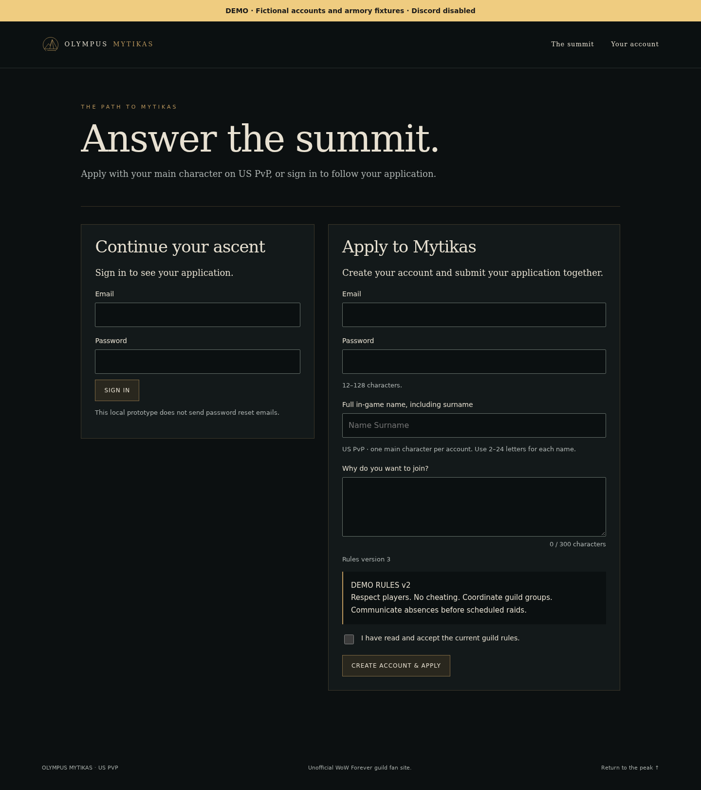
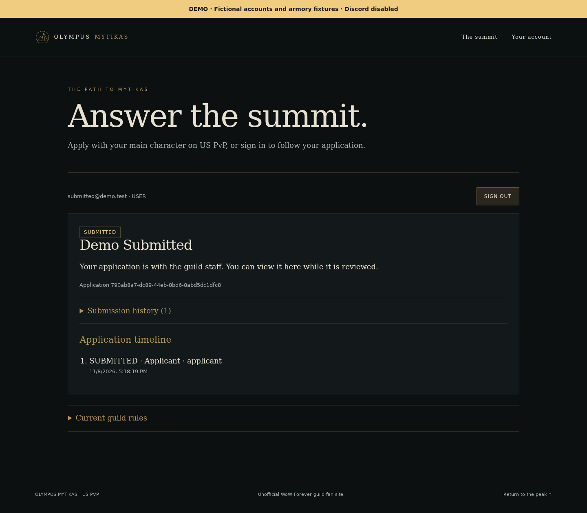
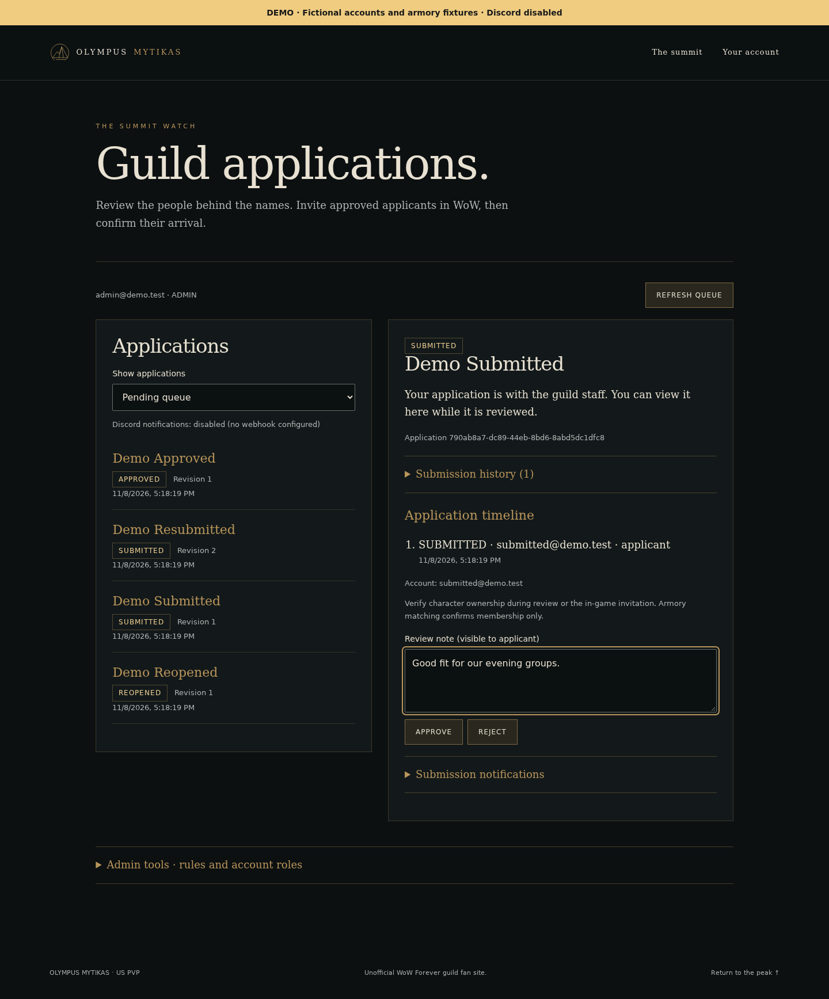
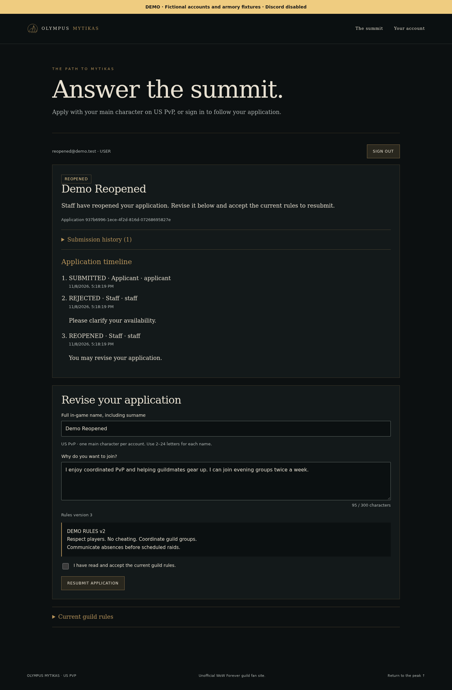
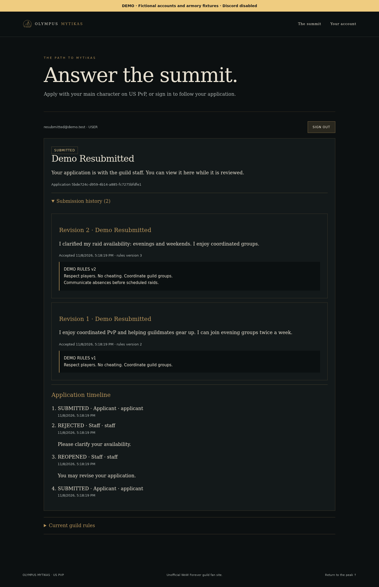
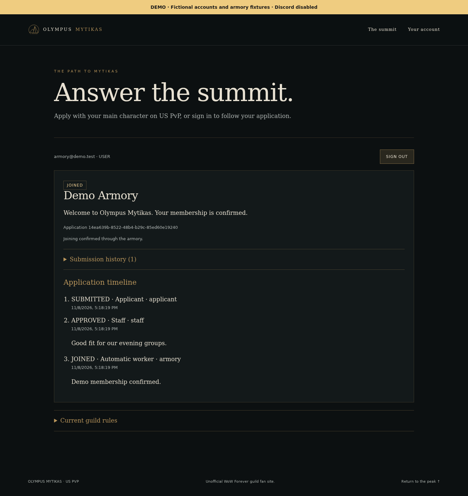

# Mytikas user manual

Mytikas lets applicants apply to Olympus Mytikas and lets staff review applications
and confirm guild membership. This guide uses the fictional demo accounts. The
normal application has the same workflow, with live armory checks.

## Open the application

From the repository, start the demo and display its account credentials:

```sh
./mytikas.sh demo up
./mytikas.sh demo accounts
```

Open **[localhost:8081](http://localhost:8081)**. The yellow banner identifies the
demo: its armory results are fixtures and Discord notifications are disabled.
Choose **Apply / sign in** to open your account.


For normal use, run `./mytikas.sh up` and open
**[localhost:8080](http://localhost:8080)**. Normal and demo accounts have separate
databases and session cookies, so you can sign in to both in the same browser.

## Create an account or sign in

New applicants complete **Apply to Mytikas**:

1. Enter an email address and a password of 12–128 characters.
2. Enter your full in-game character name and a motivation of up to 300 characters.
3. Read the current guild rules and check the acceptance box.
4. Choose **Create account & apply**.

Existing applicants use **Continue your ascent** and choose **Sign in**. Demo
accounts already exist: use the password shown by `demo accounts`. Password reset
emails are not available in this local prototype.



## Follow your application

For this example, sign in as **submitted@demo.test**. Your account shows your
character, current status, submission history, and application timeline. Staff
review notes appear in that timeline. A submitted application cannot be edited;
staff must reopen it before you can revise it.



| Status | What it means / next step |
| --- | --- |
| SUBMITTED | Await staff review. |
| APPROVED | Staff approved the application; join the guild in game, then confirm membership. |
| REJECTED | Read the review note; staff can reopen the application for corrections. |
| REOPENED | Revise the application and accept the current rules before resubmitting. |
| JOINED | Membership has been confirmed. |

Use **Sign out** before switching demo accounts. Signing out of the demo preserves
your normal application login.

## Review applications as staff

Sign in as **admin@demo.test** or **moderator@demo.test**, then choose **Admin
panel**. Select **Demo Submitted** from the pending queue. Use **Show applications**
to filter by status or view all applications.

Review the motivation, accepted rules, submission history, and timeline. Add a
**Review note (visible to applicant)** when useful, then choose an available action:

- **Approve** moves a submitted application to Approved.
- **Reject** declines a submitted or approved application.
- **Reopen** lets a rejected applicant revise and resubmit.
- **Check now** verifies an approved character's guild membership.
- **Mark as joined** records a staff-confirmed invitation for an approved applicant.



Armory matching confirms membership only. Staff should verify character ownership
during review or the in-game invitation. **Refresh queue** updates the selected
application and queue after worker activity or changes made by another staff member.

Administrators also have **Admin tools · rules and account roles** for publishing
new rules and finding accounts to change their roles. Moderators can review
applications but cannot use those administrator tools. For a new normal database,
create the first administrator with `./mytikas.sh admin` in a terminal.

## Revise a reopened application

Sign in as **reopened@demo.test**. Read the staff note and scroll to **Revise your
application**. Update your character or motivation, read and accept the current
rules, then choose **Resubmit application**. The status returns to Submitted for
another staff review.



Open **Submission history** to compare revisions. Each revision retains the
motivation and rules accepted at that time; publishing new rules does not rewrite
previous submissions. Sign in as **resubmitted@demo.test** to inspect an existing
two-revision example:



## Confirm membership

After approval, the worker checks membership periodically. Applicants and staff
can also choose **Check now**, subject to a shared one-minute cooldown. Successful
verification moves the application to Joined. A missing profile, different guild,
or armory outage leaves it Approved; staff can confirm membership manually when
appropriate.

To try this safely in the demo, use **approved@demo.test**, whose character starts
outside the guild:

```sh
./mytikas.sh demo armory approved@demo.test member
./mytikas.sh demo check approved@demo.test
```

The check should return `MATCH`. Reload the account page to see Joined. If a check
was requested in the previous minute, wait for the cooldown and try again.
**armory@demo.test** already demonstrates the final result:



For the automatic path, approve **Demo Submitted** as staff. Its fixture is already
`member`, so the worker can confirm joining on its next cycle. Refresh the queue
or reload the applicant page to see the result.

## Demo accounts and fixtures

All demo accounts use the generated password printed by `demo accounts`.

| Account | Initial scenario |
| --- | --- |
| admin@demo.test | Administrator without an application |
| moderator@demo.test | Moderator without an application |
| submitted@demo.test | Submitted; member fixture |
| approved@demo.test | Approved; outsider fixture |
| rejected@demo.test | Rejected with a review note |
| reopened@demo.test | Ready for applicant revision |
| resubmitted@demo.test | Submitted with two revisions |
| manual@demo.test | Joined manually |
| armory@demo.test | Joined through the armory |

Use `./mytikas.sh demo summary` to inspect counts and fixture states. The armory
command accepts `member`, `outsider`, `missing`, or `unavailable` and targets the
applicant's current character. Unknown character profiles return 404. Demo checks
never contact Blizzard; Discord is disabled.

## Stop, resume, back up, or reset

```sh
./mytikas.sh demo down       # stop; keep the demo database
./mytikas.sh demo up         # start again; preserve walkthrough changes
./mytikas.sh --demo backup   # create a private database dump
./mytikas.sh demo reset --yes # discard demo changes and restore all examples
```

Reset removes only the demo database volume. It keeps the demo password and the
normal application's database. `demo seed` preserves existing walkthrough changes;
use reset when you need the initial examples again.

For normal operation, omit `demo` or `--demo`. Use `start` to resume existing
containers and `restart` to restart them. Use `up` to apply source or environment
changes. If the app is unavailable, check `./mytikas.sh --demo health`,
`./mytikas.sh --demo status`, and `./mytikas.sh --demo logs app worker`.
`./mytikas.sh --demo doctor` checks prerequisites and configuration.

See the [README](../README.md#compose-operations-helper-and-isolated-demo) for the
complete helper reference and verification results.

## Refresh these screenshots

With the freshly seeded demo running, run:

```sh
node --import tsx scripts/manual-screenshots.ts
```

The script captures the actual website using Playwright and checks the expected
states. It signs in to fictional demo accounts and fills an unsaved staff note;
it does not submit changes. Screenshots contain no passwords. If a walkthrough
has changed the examples, reset the demo before regenerating screenshots.
